<p align="center"></p>

# CopperPilot Retro Handheld

**A vertical pocket game console, 63 x 81 x 17 mm, in a CNC-machined metal case: STM32F412 microcontroller, 2.4-inch 320x240 IPS screen, D-pad, ABXY, Start/Select and four shoulder buttons, a 1200 mAh LiPo and USB-C charging. Designed end to end by CopperPilot from four photos and a two-line prompt.**

[](https://copperpilot.ai)  [](reviews/gates.md) [](reviews/kicad) [](reviews)  [](LICENSE)

> [!NOTE]
> **Designed by [CopperPilot](https://copperpilot.ai).** CopperPilot's agents designed every board, schematic, layout and enclosure part in this repo from one prompt and a few reference photos, then checked them with the gates and reviews below. Nobody edited the design files by hand. The whole prompt was two lines ("Build me a handheld retro game console like the one in these photos. It should run simple 2D games and charge over USB-C."); the agents chose the parts, drew and routed the board, modelled the case and fixed every review finding themselves. **It has not been fabricated, assembled or powered on yet.** Everything here is open for review: if you see something a senior engineer would flag, [open an issue](../../issues/new/choose).

One two-layer board fills the case behind the screen. It carries the STM32F412 microcontroller, the button matrix
(surface-mount tact switches under the D-pad, face and shoulder buttons), the display's 18-pin ZIF connector, the
USB-C port and the battery charger. The LiPo pack sits behind the board; the CNC case is a front and a rear shell
with machined button caps and a display window.

## Status

### Done

- [x] Schematic: KiCad ERC, 0 errors
- [x] Layout: KiCad DRC with schematic parity and zone refill, 0 errors, 0 unconnected
- [x] Board rules no looser than the fab's limits, nothing silenced
- [x] Every part on the footprint and 3D model of its exact LCSC part
- [x] Every placed part has a live, in-stock LCSC/JLCPCB part number
- [x] High-speed groups (USB, MIPI, DDR where present) routed, length-matched, on target impedance
- [x] Every user-facing connector opens towards its case opening (checked on its 3D model)
- [x] Every connector mates from a known side, with a keep-clear zone KiCad DRC enforces
- [x] Both ends of every board-to-board cable carry the same signal on each wire
- [x] Datasheet-level design review: 0 P0 and 0 P1 findings open on every board
- [x] Enclosure parts are closed solids that fit the product envelope
- [x] Every enclosure part is manufacturable by its process (wall thickness, build size)
- [x] Full assembly with the real PCBAs: no collisions, seated or along any insertion path
- [x] Every cable joins two real connectors and fits its route in every pose
- [x] Every connector faces what mates with it; every screw hole sits on a boss
- [x] Every port opening has its connector right behind it
- [x] Every button and control physically reaches the switch it works
- [x] Every part is held by something real (screw, snap, clip, adhesive, press fit)
- [x] Gerbers, drill, BOM and CPL exist and agree with the PCB
- [x] Independent judge (compares renders to the reference photos): **9/10** ([notes](reviews/judge.md))

### Pending

- [ ] Gate `sourcing.bom` warn: 18 extended parts (each adds a JLCPCB feeder fee); prefer basic parts where equivalent
- [ ] Gate `kicad.drc` warn: DRC warning silk_over_copper x84
- [ ] **Not built.** The board has not been fabricated or assembled and the case has not been machined.
- [ ] **No firmware.** The game runtime, display driver, button scanning and battery monitoring for the STM32 are not written or tested.
- [ ] **Bought parts are specified from drawings.** The display module and the battery pack are modelled from their published drawings; the exact supplier parts still have to be confirmed against those models.
- [ ] **Thermal and battery life not measured.** No runtime estimate has been checked on hardware.

0 P0 · 0 P1 · 0 P2 review findings open; the full reviews with evidence and suggested fixes are in [reviews/](reviews). Every P0 and P1 the reviews raised was fixed before release.

## Build film

[docs/build-film.mp4](docs/build-film.mp4) (48 s, 720p). Every part moves in the assembly order and along the insertion path that the collision gates checked, and every cable is drawn along its real route.

## Renders

| | |
|:---:|:---:|
| 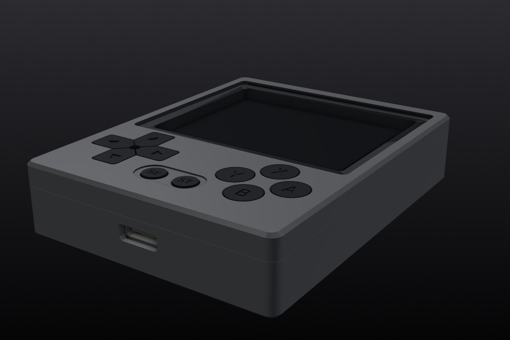<br>*Three-quarter view* | 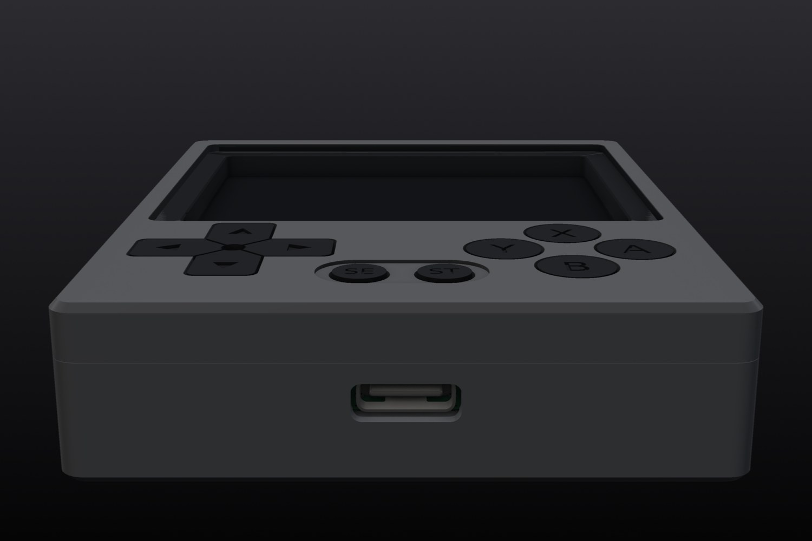<br>*Front* |
| 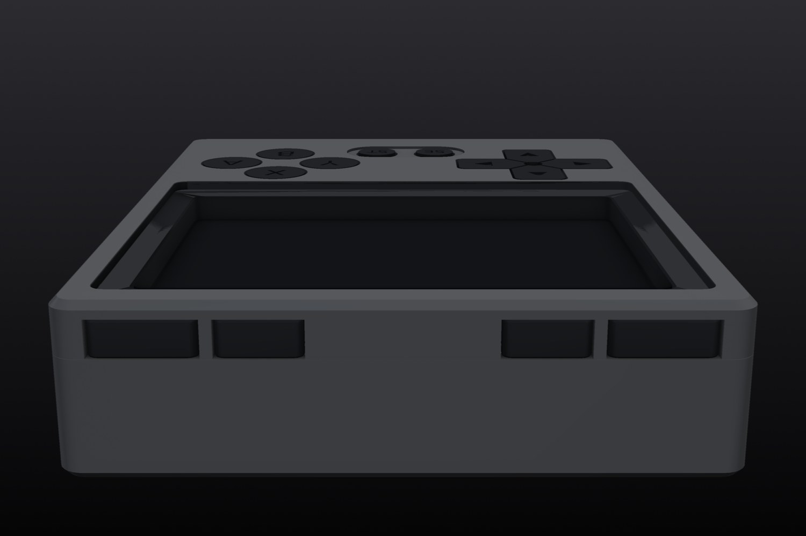<br>*Rear* | 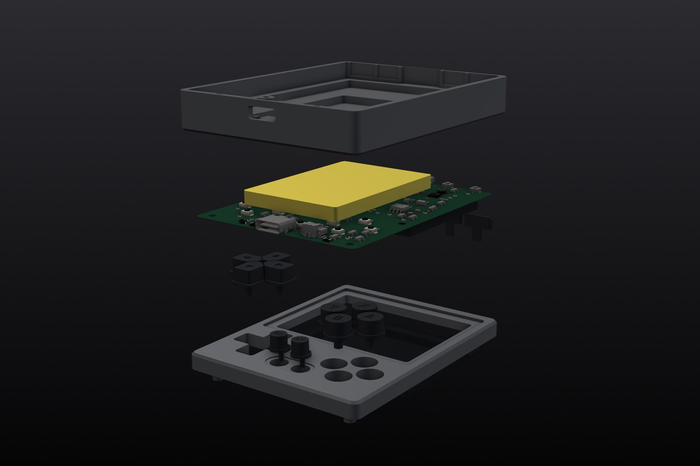<br>*Exploded* |
| 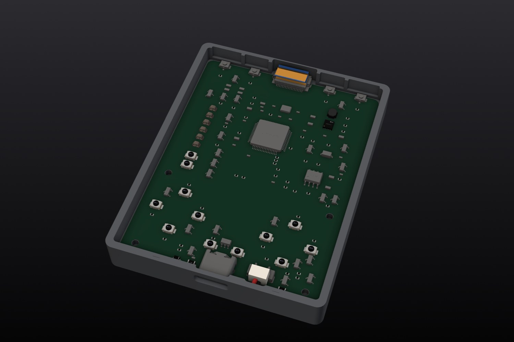<br>*Inside, top cover lifted away, every cable* | 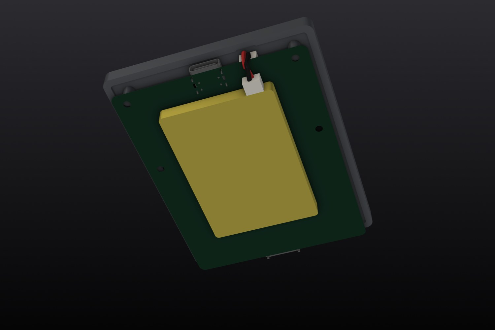<br>*Inside from below, bottom cover lifted away* |
| 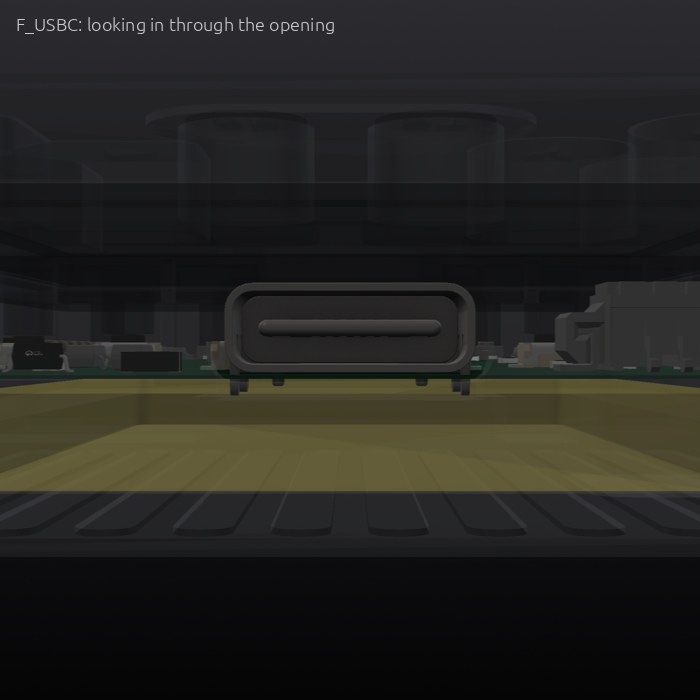<br>*Ports* | 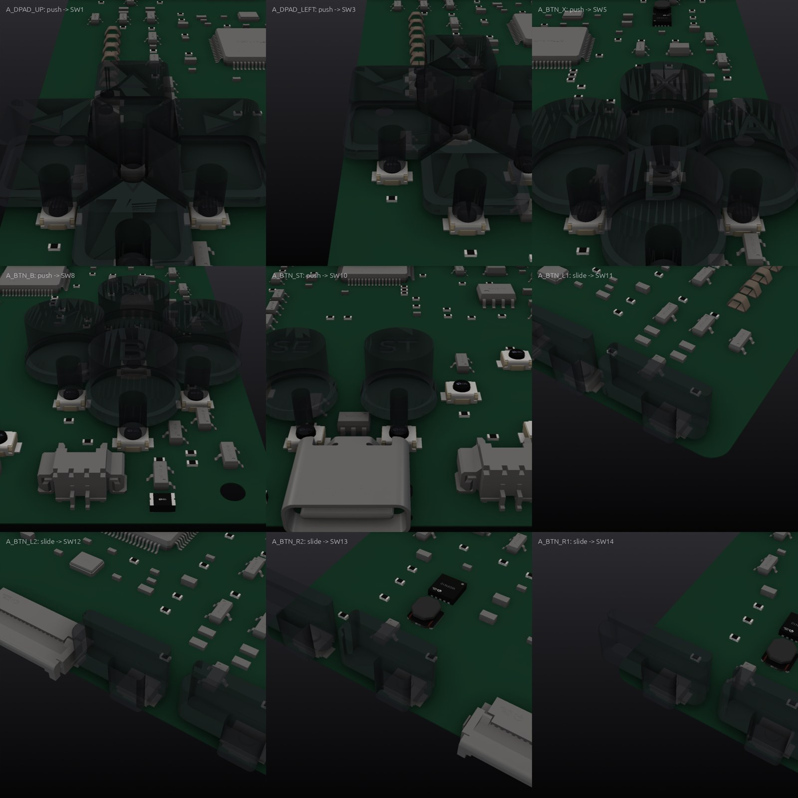<br>*Buttons and controls, next to the parts they press* |

## What's inside

**Power path:** USB-C (5 V, ESD-protected) → TP4056 linear charger → 1S 1200 mAh LiPo (pack with its own protection
board) → P-FET/Schottky power path → RT6150 buck-boost to a steady 3.3 V across the whole battery range.
**Display:** 2.4-inch 320x240 IPS module (ILI9341 class) over SPI on a 0.5 mm FPC, backlight switched by a MOSFET.

| Board | Size | Layers | Parts | Tracks | Vias | KiCad project | Review |
|---|---|---|---|---|---|---|---|
| Main board | 58 × 76 mm | 2 | 140 | 3,190 | 241 | [`hardware/pocket-retro-handheld.kicad_pro`](hardware/pocket-retro-handheld.kicad_pro) | [0 P0 · 0 P1](reviews/review-main.md) |

**Bought parts** (modelled from their drawings; the assembly checks use these models):

- **Display**: 2.4-inch 4:3 320x240 IPS TFT LCD module
- **Battery**: 1S 3.7V 1200mAh 503450 Li-Polymer rechargeable battery pack with built-in PCM protection and 2-pin 1.25mm Molex PicoBlade lead

## How it was made

CopperPilot's agents worked from the prompt in [reference/prompt.md](reference/prompt.md) and 4 reference photos ([reference/](reference)). The pipeline scopes the product into a written contract ([design/spec.yaml](design/spec.yaml)), designs the boards and the enclosure in parallel, integrates them, and only moves on when the gates pass. A separate review agent reads every board against the part datasheets, and a separate judge compares the result with the photos.

- Pipeline wall clock: about **19 h** over 4 launches (pipeline v98 to v105).

**Reference vs build:**

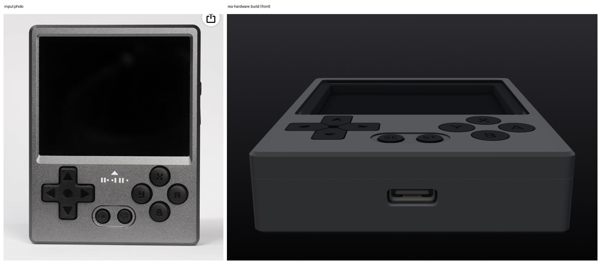
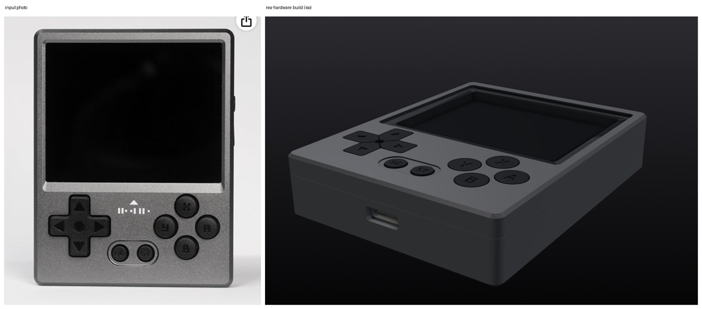
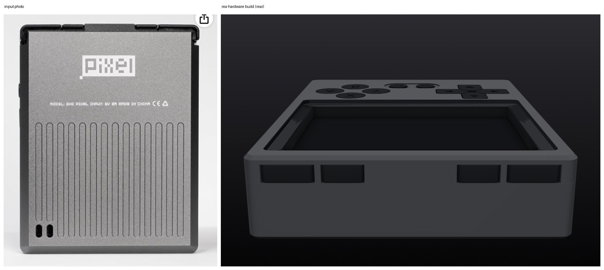

<sub>Reference photos of a commercial product, used here only for comparison. All rights belong to their owners; this project is not affiliated with or endorsed by the product's maker.</sub>

## Repository layout

```
hardware/          KiCad 10 projects (main board at the top, daughter boards in their own folders)
  lcsc.*, rea_refs.*   symbols, footprints and 3D models for every part, so the project opens anywhere
case/out/          enclosure parts (STL)
case/purchased/    bought parts used in the assembly checks
case/generate_case.py  the parametric enclosure source (uses CopperPilot's CAD helpers, not yet public)
fab/               Gerbers, drill, BOM, CPL, schematic PDF and STEP for each board; fab/mech/ enclosure STEP/STL
design/spec.yaml   the design contract the agents wrote and the gates check
reviews/           gate report, design reviews, the judge's notes, KiCad ERC/DRC
reference/         the prompt and the reference photos
docs/              build film and renders
```

## Manufacture

Every board targets **JLCPCB** standard PCB + assembly (1.6 mm FR-4); every part has an LCSC number. Per board: upload `*-gerbers.zip`, then `*-bom.csv` and `*-cpl.csv` for assembly, and check the part rotations in JLCPCB's preview before ordering.

The case (`fab/mech/`) is designed for CNC-machined 6061 aluminium (anodised); STEP files are included for machining
quotes and STLs for test prints.

> [!WARNING]
> This design has not been built yet. Fix or accept the open review findings above before you order boards, and expect a first revision to need changes.

## Review this design

Hardware gets better with more eyes on it. We'd like to hear what you'd flag:

- **Open an issue** ([design review template](../../issues/new/choose)) for a wrong pin, a missing part, a tight clearance, a part you'd swap, or a P1 above you disagree with.
- **Send a pull request** with a fix. Say which board and which reference designators it touches.
- **Build one** and tell us how it went: photos, bring-up notes and failures are all welcome.

Start with [reviews/](reviews): every finding has its evidence and a suggested fix.

## License

[CERN-OHL-S-2.0](LICENSE). You may use, study, modify, make and sell products from this design; modified versions must be shared under the same licence.

Part and product names are used only to say what fits; all trademarks belong to their owners.

<p align="center"><a href="https://copperpilot.ai"><b>Designed by CopperPilot</b></a>: we accelerate hardware design.<br><sub>More open designs: <a href="https://github.com/CopperPilot">github.com/CopperPilot</a></sub></p>
